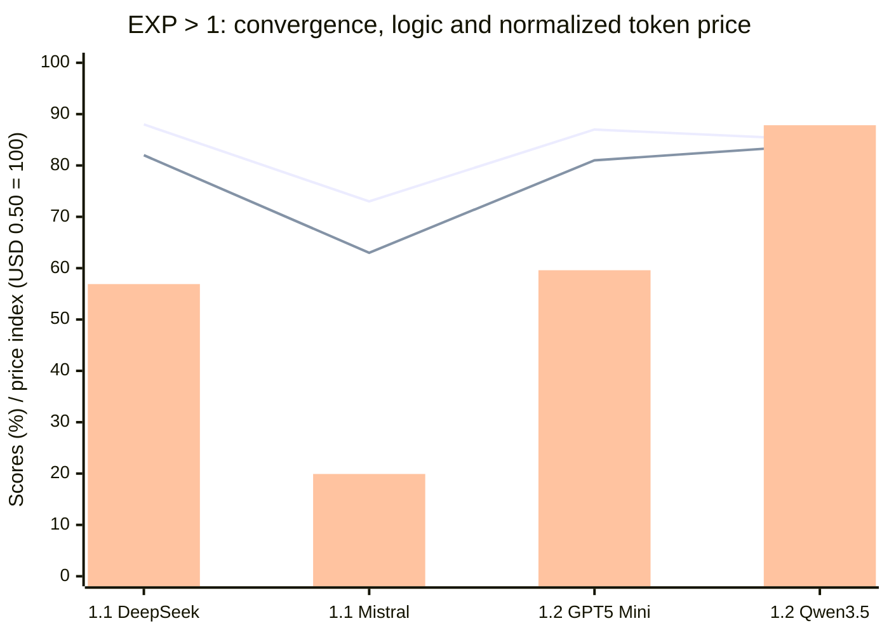
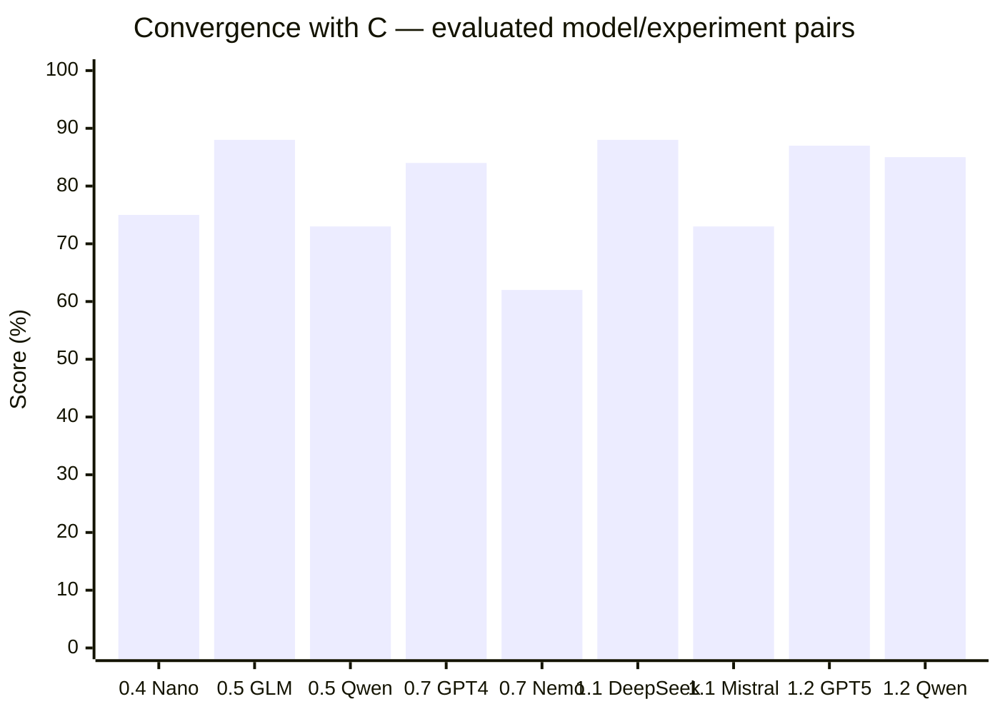
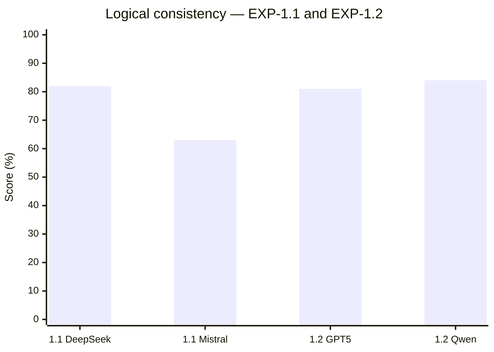
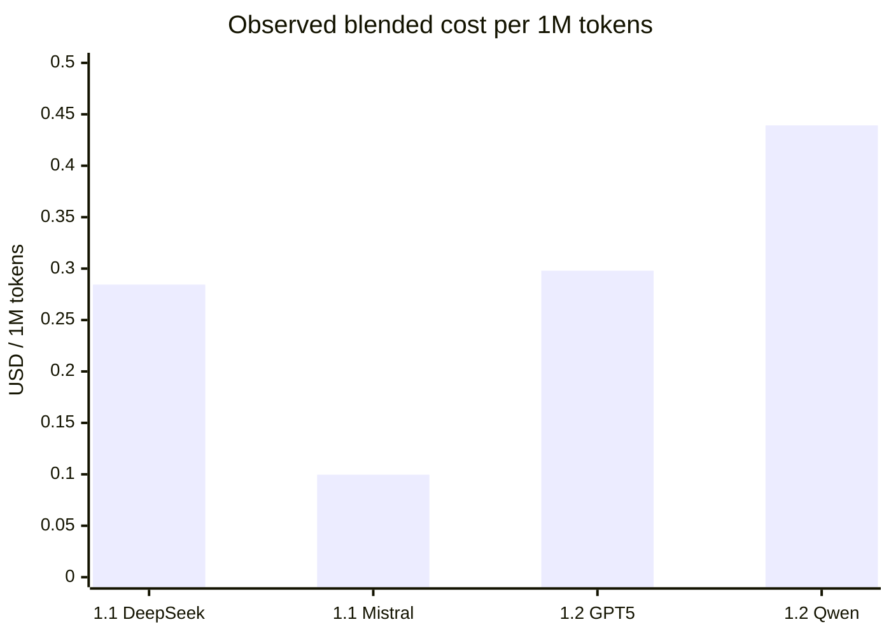

# Aletheon — model comparison and effective token cost

> Convergence and logical-consistency scores are **subjective preliminary judgments**, not validated measurements. Missing values are unknown, not zero. Effective token prices are observed from archived provider usage, not public tariffs.

## Unified comparison — EXP > 1 (EXP-1.1 and EXP-1.2)

One chart, four model/experiment pairs, three measures. **Convergence and logical consistency are percentages.** The token-price series uses a separate explicitly defined normalization: **USD per million total tokens divided by $0.50, multiplied by 100**. This permits a single 0–100 axis without pretending that dollars are percentages. **Lower token price is better; higher scores are better.** Exact unscaled USD values are in the table below.

**Series in drawing order:** first line = convergence with C (%); second line = logical consistency (%); bars = normalized effective token cost (price index). Mermaid's `xychart-beta` does not consistently display a legend, so series are specified here. Values are preliminary subjective scores and observed costs; this is not a statistically validated performance benchmark.

| Experiment | Model | Convergence (%) | Logic (%) | Effective USD / 1M tokens | Price index (0–100) |
|---|---|---:|---:|---:|---:|
| EXP-1.1 | DeepSeek V3.2 | 88 | 82 | $0.28448 | 56.90 |
| EXP-1.1 | Mistral Small 3.2 | 73 | 63 | $0.09961 | 19.92 |
| EXP-1.2 | GPT-5 Mini | 87 | 81 | $0.29799 | 59.60 |
| EXP-1.2 | Qwen3.5 Plus | 85 | 84 | $0.43921 | 87.84 |

This chart is the **primary summary graphic for all EXP > 1 results**. Append future EXP-1.x entries to the same chart and table, preserving the normalization reference ($0.50 per million tokens) or explicitly revising it if costs exceed the axis.

## Convergence with frozen C (%)

## Logical consistency (%): only experiments actually assessed

## Average effective token price (USD per 1 million tokens)

Calculated as **sum of actual USD cost / sum of (prompt_tokens + completion_tokens) × 1,000,000**, pooling H1 and H2 for each model. This is a **token-weighted blended effective price**, not the arithmetic mean of input and output tariffs. Includes billed reasoning tokens where reported. Source: raw `*.response.json` usage in uploaded EXP-1.1 and EXP-1.2 archives.

## Summary table

| Experiment | Model | Convergence C | Logical consistency | Actual USD / 1M total tokens | Average actual USD / answer |
|---|---|---:|---:|---:|---:|
| EXP-0.4 | GPT-4.1 Nano | ~75% | — | — | $0.00104 |
| EXP-0.4 | DeepSeek V3.2 (blocked) | — | — | — | — |
| EXP-0.5 | GLM-4.5 Air | ~88% | — | — | $0.00270 |
| EXP-0.5 | Qwen3 32B | ~73% | — | — | $0.00145 |
| EXP-0.6 | GPT-4.1 Mini (blocked) | — | — | — | — |
| EXP-0.6 | Ministral 8B (overlong) | — | — | — | $0.00139 |
| EXP-0.7 | GPT-4.1 Mini | ~84% | — | — | $0.00611 |
| EXP-0.7 | Nemotron 3 Nano | ~62% | — | — | $0.00110 |
| EXP-1.1 | DeepSeek V3.2 | ~88% | ~82% | $0.28448 | $0.00418 |
| EXP-1.1 | Mistral Small 3.2 | ~73% | ~63% | $0.09961 | $0.00152 |
| EXP-1.2 | GPT-5 Mini | ~87% | ~81% | $0.29799 | $0.00424 |
| EXP-1.2 | Qwen3.5 Plus | ~85% | ~84% | $0.43921 | $0.00687 |

The earlier experiment records available in this review contain answer-level costs but not a verified matching count of billed tokens. Their effective prices remain blank pending raw usage recovery.

## Super-short experiment conclusions

- **EXP-0.4:** Budget blocked DeepSeek; GPT Nano gave partial comparison.
- **EXP-0.5:** GLM was the closer of two tested models to frozen C.
- **EXP-0.6:** Budget and overlength responses prevented acceptance.
- **EXP-0.7:** All four accepted; Nemotron revealed contradictions despite similar decisions.
- **EXP-1.1:** DeepSeek argued more coherently than Mistral; both broke some H1 constraints.
- **EXP-1.2:** Both accepted; GPT-5 Mini was more procedural, Qwen3.5 Plus more concise.

Technical acceptance is not semantic correctness. The model/experiment pair, not the model alone, is the unit of comparison.
