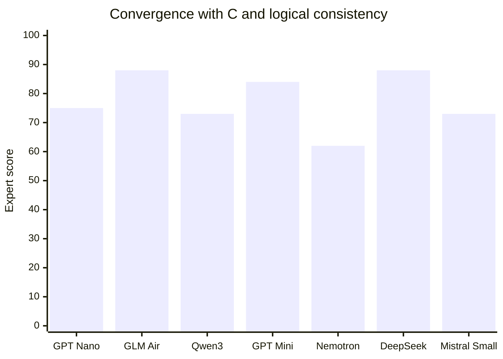
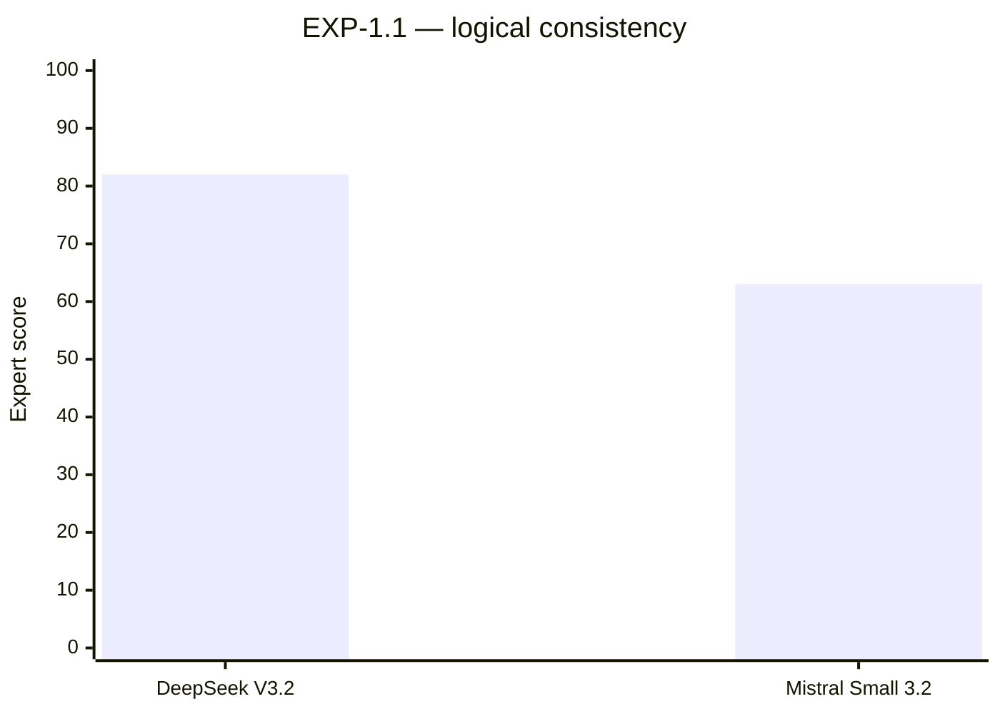

# Aletheon — convergence and logical consistency

> Scores are **subjective preliminary assessments** (0–100), not a validated benchmark. A blank means **not evaluated**, not zero.

## Comparative chart

**Logical consistency (only EXP-1.1 assessed):**

Historical logical-consistency scores are missing, **not zero**. Separate plots avoid implying that older experiments received scores.

| Experiment | Model | Convergence with C | Logical consistency | Average cost / answer |
|---|---|---:|---:|---:|
| EXP-0.4 | GPT-4.1 Nano | ~75% | — | $0.00104 |
| EXP-0.4 | DeepSeek V3.2 | — | — | — |
| EXP-0.5 | GLM-4.5 Air | ~88% | — | $0.00270 |
| EXP-0.5 | Qwen3 32B | ~73% | — | $0.00145 |
| EXP-0.6 | GPT-4.1 Mini | — | — | — |
| EXP-0.6 | Ministral 8B | — | — | $0.00139 |
| EXP-0.7 | GPT-4.1 Mini | ~84% | — | $0.00611 |
| EXP-0.7 | Nemotron 3 Nano | ~62% | — | $0.00110 |
| EXP-1.1 | DeepSeek V3.2 | ~88% | ~82% | $0.00418 |
| EXP-1.1 | Mistral Small 3.2 | ~73% | ~63% | $0.00152 |

## One-line experiment conclusions

- **EXP-0.4:** Budget blocked DeepSeek; GPT Nano supplied the first partial comparison.
- **EXP-0.5:** GLM was the strongest match with C among two fully tested models.
- **EXP-0.6:** Budget and word limit defeated acceptance, despite two complete Ministral responses.
- **EXP-0.7:** All four passed; Nemotron exposed why correct conclusions are not enough.
- **EXP-1.1:** DeepSeek argued more consistently than Mistral, though both selected C-like outcomes.

**Scope:** Same loading level (Base + Extended + Evolution) throughout the current cycle. Cost means observed cost divided by the number of actual answers; blocked requests are not priced. Do not interpret missing logic scores as zeros.
