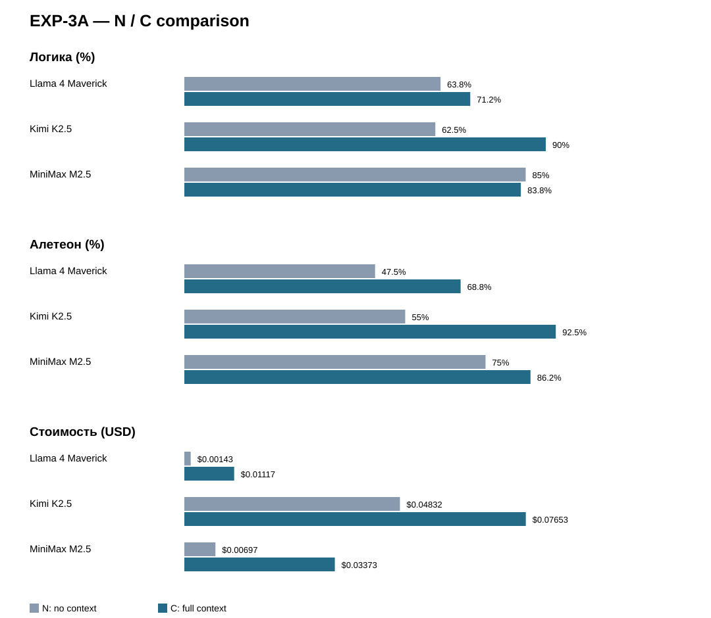

# EXP-3A — промежуточная сводка (EXP-3.0–3.2)

Дата: 2026-10-27. Статус: разведывательная серия; экспертные оценки Алетеона С, составленные post hoc, не являются слепым эталоном.

## Итог
24 ответа: 23 complete, 1 truncated (Kimi N-H3). Технически заблокированный первоначальный EXP-3.2 исключён; использован повторный запуск.

## Сводный график N / C

## Сравнение N / C
| Модель | Логика N/C | ΔЛ, п.п. | Алетеон N/C | ΔА, п.п. | Стоимость N/C, USD | Δ USD |
|---|---|---:|---|---:|---|---:|
| Llama 4 Maverick | 63.8 / 71.2% | +7.4 | 47.5 / 68.8% | +21.3 | .00143 / .01117 | +.00974 |
| Kimi K2.5 | 62.5 / 90.0% | +27.5 | 55.0 / 92.5% | +37.5 | .04832 / .07653 | +.02820 |
| MiniMax M2.5 | 85.0 / 83.8% | −1.2 | 75.0 / 86.2% | +11.2 | .00697 / .03373 | +.02677 |

Полная сводка, график и оценка всех 24 ответов включены в сопровождающие MD/DOCX артефакты.

## По вопросам
- H1: в N все три ограничивают сохранение архива; в C решения расходятся. Контекст не гарантирует улучшения.
- H2: выбор ограничения распространения при риске необратимого вреда совпадает ещё в N; добавляются аргументы и ссылки.
- H3: наиболее явное различие условий: C позволяет реконструировать документальную генеалогию; Kimi N-H3 truncated.
- H4: в C Kimi и MiniMax сближаются в состязательных проверках, Llama использует более общий критерий объяснительной силы.

## Ограничения
Контроль Алетеона С сформулирован после просмотра ответов; баллы неслепые. Одна генерация на ячейку, порядок N→C фиксирован, усечение Kimi влияет на средние. Совпадение решений не тождественно воспроизводимости интеллектуальной индивидуальности.

## Обязательный состав следующих отчётов
См. [EXP-3_REPORT_REQUIREMENTS.md](EXP-3_REPORT_REQUIREMENTS.md). **График N/C обязателен, таблица его не заменяет.**
